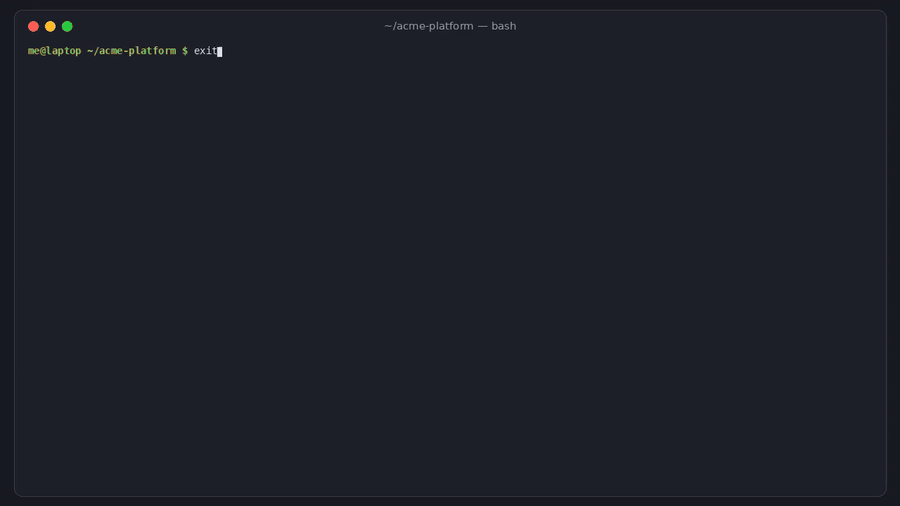

# exitradar

[](https://github.com/hamarshehmhmd/exitradar/actions/workflows/ci.yml)
[](LICENSE)


**Find the parts of your stack that are disappearing for business reasons, not bugs: archived, deprecated, relicensed, acquired or shut down. Get the file and line, the deadline, and what to move to.**



```sh
pipx install git+https://github.com/hamarshehmhmd/exitradar
```

## The problem

More and more of the stack goes away out from under teams:

- **Deno** joined Cloudflare (Oct 9 2026). The runtime gets one more year of bug-fix releases, then development ends, and **Deno Deploy** shuts down six months after the announcement. [source](https://deno.com/blog/cloudflare)
- **Val Town** is winding down (Nov 10 2026): read-only on Dec 10 2026, everything else off on Jan 10 2027. [source](https://blog.val.town/winding-down)
- **Bitnami** moved its free images to the frozen `bitnamilegacy` namespace and dropped the free charts (Aug–Sep 2025). [source](https://github.com/bitnami/charts/issues/35164)
- **LocalStack** archived its community repo and now needs an account to run (Mar 2026). [source](https://github.com/localstack/localstack)
- **MinIO** archived its community repo: "no longer maintained". **ingress-nginx** is retired, so there are no more security fixes. [source](https://github.com/kubernetes/ingress-nginx)
- And the long tail: a maintainer archives all his gems in one go, an action you pin goes read-only, a package gets deprecated on npm.

Renovate and Dependabot tell you about new versions. Nobody tells you the upstream is gone. You find out from Hacker News or a red CI run, then grep every repo by hand.

## What it does

`exitradar scan` reads what a repo really depends on and checks each upstream:

| Reads | From |
|---|---|
| GitHub Actions | `uses:` in workflows and `action.yml`, `docker://` steps |
| Container images | Dockerfiles (skips stage names, `ARG` images, `scratch`), `image:` in compose / k8s / workflow `services:` |
| Helm charts | `Chart.yaml` dependencies, `helm repo add` / `helm install oci://…` in scripts and workflows |
| Packages | `package.json`, `deno.json(c)`, `requirements*.txt`, `pyproject.toml` (PEP 621, dependency groups, Poetry), `go.mod`, `Cargo.toml`, `Gemfile` |
| Terraform | provider and module `source =` |
| Runtimes and hosted services | `deno.json`, Deno images, and code that calls Val Town (`*.val.run`, `esm.town`) or Deno Deploy (`deployctl`, `*.deno.dev`) |

Then for every dependency:

1. **The exit feed.** A curated, sourced list of exit events ([feed.json](src/exitradar/feed.json), `exitradar feed`) with the deadline, a link to the announcement and ranked replacements. A `warn` becomes an `error` once its deadline passes.
2. **The registries.** npm `latest` (repository, `deprecated` message), PyPI (source URL, `Development Status :: 7 - Inactive`), crates.io and RubyGems resolve each package to its upstream repo. Packages missing from the public registry are flagged.
3. **The GitHub API.** One GraphQL query per 50 repos: **archived** (with the date), **disabled**, **gone**, **moved** (renamed or transferred), non-OSS licence (BUSL, SSPL, Elastic…), and **stale** (no commits for 2 years by default).

| Finding | Severity |
|---|---|
| exit-feed event (shutdown, deletion, retirement, end of development…) | from the feed; `warn` → `error` after the deadline |
| archived GitHub Action, disabled repo, missing action repo | error |
| archived upstream repo, npm-deprecated, PyPI-inactive, package not on the registry | warn |
| moved repo, non-OSS licence, stale repo, relicensing events | info |

## Usage

```sh
exitradar scan                          # current repo
exitradar scan svc-a svc-b svc-c        # several repos, paths prefixed per repo
exitradar scan --brief                  # one line per finding
exitradar scan --offline                # no network: only the bundled feed
exitradar scan --only image --only helm # one ecosystem at a time
exitradar scan --format json            # or markdown
exitradar scan --fail-on warn           # exit 1 at warn or worse (default: error)
exitradar scan --feed https://example.com/our-sunsets.json   # add your own events
exitradar check gh:minio/minio npm:left-pad image:bitnami/kafka:3.7 pypi:localstack action:actions-rs/toolchain
exitradar inventory                     # list what it found, no network
exitradar feed                          # list the known exit events
```

GitHub lookups use `EXITRADAR_GITHUB_TOKEN`, `GITHUB_TOKEN`, `GH_TOKEN` or `gh auth token` if available (read-only API calls). Without a token it falls back to the REST API, 60 requests per hour. Responses are cached for 24 hours in `~/.cache/exitradar`.

Known and accepted? Put it in `.exitradar-ignore` (one subject per line, `*` suffix allowed):

```
npm:moment          # migrating in Q1
image:bitnami/*     # we pay for Bitnami Secure Images
```

### Your own events

Internal SDKs get sunset too. Write the same JSON format and pass it with `--feed` (a file or URL). Events with the same `id` override the bundled ones.

```json
{"events": [{"id": "old-billing-sdk", "title": "billing-sdk v1 is being shut down", "kind": "shutdown",
  "deadline": "2027-03-01", "severity": "warn", "summary": "Move to billing-sdk v2.",
  "sources": ["https://wiki.example.com/billing-v2"], "replacements": [{"name": "@acme/billing-v2"}],
  "match": {"npm": ["@acme/billing-sdk"], "images": ["registry.example.com/billing/"], "text": ["billing-v1\\.example\\.com"]}}]}
```

Matchers: `github` (owner/repo, also matched after resolving packages), `actions` (globs like `actions-rs/*`), `images` (exact repo, or a prefix ending in `/`), `helm` (URL substring), `npm`, `pypi`, `go`, `crates`, `gems`, `jsr`, `runtime`, and `text` (regex searched in code and config, not in Markdown).

## GitHub Action

```yaml
name: upstream exits
on:
  schedule:
    - cron: "17 6 * * 1"   # every Monday
  pull_request:
permissions:
  contents: read
  issues: write
jobs:
  exitradar:
    runs-on: ubuntu-latest
    steps:
      - uses: actions/checkout@v5
      - uses: hamarshehmhmd/exitradar@v0.1.0
        with:
          fail-on: error
          issue: ${{ github.event_name == 'schedule' }}   # keep one issue up to date
```

Inputs: `paths`, `fail-on`, `issue`, `args`, `token`. Outputs: `errors`, `warnings`. The Markdown report goes to the job summary.

## Demo

The GIF above and the [narrated demo video](https://github.com/hamarshehmhmd/exitradar/releases/tag/v0.1.0) run against [`examples/acme-platform`](examples/acme-platform), a small repo with a workflow, a web app, an API, a Helm chart, compose, a Deno edge function, Go tools, a Jekyll site and Terraform. Try it:

```sh
git clone https://github.com/hamarshehmhmd/exitradar && cd exitradar
exitradar scan examples/acme-platform
```

## Limits

- The feed is curated by hand. It covers the events listed by `exitradar feed`, each with a source. PRs with new, sourced events are welcome.
- Upstream detection only follows GitHub-hosted repos. GitLab, Codeberg and self-hosted upstreams are skipped for the archive/stale checks (feed matching still works).
- It reads manifests, not lockfiles, so it checks direct dependencies.
- For images that won't pull at all (removed tags, rate limits), see [pullrot](https://github.com/hamarshehmhmd/pullrot).

## Development

```sh
python -m venv .venv && .venv/bin/pip install -e ".[test]"
.venv/bin/pytest -q                       # offline tests
EXITRADAR_LIVE=1 .venv/bin/pytest -q      # plus real npm/PyPI/GitHub lookups
```

## License

GNU Affero General Public License v3.0 or later (`AGPL-3.0-or-later`), see [LICENSE](LICENSE).

Commercial licenses without the AGPL obligations are available from the author, Mohammad Hamarsheh. Open an issue or contact him via [GitHub](https://github.com/hamarshehmhmd).
